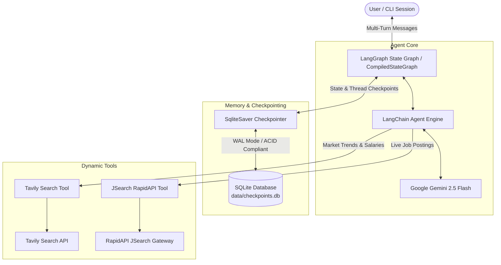

# SkillMap AI Agent with Conversational Memory 🗺️🤖

> **A Production-Grade, Multi-Turn Career & Skill Intelligence Agent Built with LangChain, LangGraph, Google Gemini, and Persistent SQLite Checkpointing.**

---

## 📌 Project Overview

**SkillMap AI Agent** is an agentic AI system designed to help engineering students and aspiring developers bridge the gap between emerging technology trends and real-world employment opportunities. 

While traditional job aggregators present static search results, SkillMap analyzes real-time industry skill demand (via **Tavily Search API**) and dynamically couples it with live, junior-accessible job and internship openings (via **RapidAPI JSearch**).

Crucially, SkillMap implements **persistent conversational memory** using **LangGraph** and **SQLite (`SqliteSaver`)**. Unlike standard in-memory chatbot prototypes that lose context when the process terminates, SkillMap preserves full conversation history, tool calls, and agent state across application restarts and system crashes.

---

## 🏛️ System Architecture



### Key Architectural Decisions

1. **State Persistence via LangGraph & SQLite Checkpointer**:
   - Replaced ephemeral `InMemorySaver` with `langgraph-checkpoint-sqlite` (`SqliteSaver`).
   - SQLite database runs with `PRAGMA journal_mode=WAL` (Write-Ahead Logging) and `PRAGMA synchronous=NORMAL` to prevent database locks on Windows and guarantee transactional atomicity across agent runs.
   - Conversations are isolated by `thread_id`, enabling independent user sessions.

2. **Clean Separation of Concerns**:
   - Configuration management decoupled from application code (`skillmap/config.py`).
   - Tool factories encapsulate API secrets and provide graceful degradation when credentials are missing.
   - Clean CLI runner with rich interactive terminal interface and non-interactive command modes.

3. **Safe Content Extraction**:
   - Google Gemini message content structures (which can return structured text dictionaries or multipart chunks) are normalized via `extract_response_text` to guarantee clean CLI and downstream parsing.

---

## 📁 Repository Structure

```
skillmap-ai-agent/
├── .env.example              # Template for environment variables (safe to commit)
├── .gitignore                # Protects secrets, local databases, and caches
├── requirements.txt          # Pinned project dependencies
├── README.md                 # Project documentation & architecture guide
├── main.py                   # Clean CLI entry point (interactive & scriptable)
├── test_memory.py            # Automated memory verification script (tests restarts)
├── skillmap/                 # Core Python package
│   ├── __init__.py           # Package exports
│   ├── config.py             # Secure environment handling & validation
│   ├── prompts.py            # System prompt and assistant guidelines
│   ├── memory.py             # SQLite checkpointer setup and thread queries
│   ├── agent.py              # LangGraph agent compilation & message extraction
│   └── tools/                # Agent tools
│       ├── __init__.py       # Tool registry
│       ├── skill_demand.py   # Tavily Search tool implementation
│       └── job_search.py     # RapidAPI JSearch tool implementation
└── tests/
    ├── __init__.py
    └── test_suite.py         # Pytest suite for config, tools, isolation & memory
```

---

## ⚡ Quickstart & Installation

### 1. Prerequisites
- Python 3.10+ (tested on Python 3.11)
- Git

### 2. Clone Repository & Setup Virtual Environment
```bash
# Clone the repository
git clone https://github.com/Mohith-WORLD/skillmap-ai-agent.git
cd skillmap-ai-agent

# Create virtual environment
python -m venv .venv

# Activate virtual environment
# On Windows (PowerShell):
.venv\Scripts\Activate.ps1
# On macOS / Linux:
source .venv/bin/activate
```

### 3. Install Dependencies
```bash
pip install -r requirements.txt
```

---

## 🔑 Configuration

SkillMap adheres strictly to the **12-Factor App methodology**: no API keys are hardcoded in code.

1. Copy the example configuration:
   ```bash
   cp .env.example .env
   ```
2. Populate `.env` with your API keys:
   ```env
   # Google Gemini API (Required for LLM)
   GOOGLE_API_KEY=your_actual_gemini_api_key

   # Tavily Search API (Required for skill market research)
   TAVILY_API_KEY=your_actual_tavily_api_key

   # RapidAPI JSearch (Required for live job listings)
   RAPIDAPI_KEY=your_actual_rapidapi_key

   # Optional overrides
   GEMINI_MODEL=gemini-2.5-flash
   SQLITE_DB_PATH=data/checkpoints.db
   ```

### Obtaining API Keys
- **Google Gemini**: Obtain free tier API key from [Google AI Studio](https://aistudio.google.com/app/apikey).
- **Tavily Search**: Register for a developer account at [Tavily](https://tavily.com/).
- **JSearch**: Subscribe to the JSearch API at [RapidAPI](https://rapidapi.com/letscrape-6bRBa3QguO5/api/jsearch).

---

## 🚀 Usage

### 1. Check Configuration Status
Verify that your environment credentials and database settings are loaded:
```bash
python main.py --status
```

### 2. Interactive Terminal Chat
Launch the conversational agent with persistent memory:
```bash
python main.py --thread-id student_session_1
```

Inside the interactive session:
- Chat naturally with the agent.
- Type `history` to view the full dialogue tree for this thread.
- Type `threads` to inspect all active threads saved in SQLite.
- Type `exit` or `quit` to leave. When you relaunch with the same `--thread-id`, your conversation resumes immediately!

### 3. Single-Query Mode (Scriptable)
Send a single query to a specific thread:
```bash
python main.py --thread-id student_session_1 --query "What is the demand for Generative AI in India?"
```

### 4. Inspect Thread History
```bash
python main.py --thread-id student_session_1 --history
```

---

## 🧪 Automated Testing & Verification

SkillMap includes an automated verification script that rigorously tests the persistence requirement from the technical brief without requiring external API credits.

### Run Memory Persistence Verification
```bash
python test_memory.py
```

This automated test executes the following sequence:
1. **Turn 1**: Asks the agent to find jobs in India.
2. **Turn 2**: Asks a follow-up question referencing *"the second job"*.
3. **Application Termination**: Closes the database, unloads the agent, and simulates process termination.
4. **Application Restart**: Reconnects to the SQLite file in a fresh process, verifies that the thread state survived, and executes **Turn 3** with continuous context.

### Run Full Pytest Suite
```bash
pytest -v
```

---

## 💬 Example Conversation Transcript

Here is a verified multi-turn interaction demonstrating contextual recall across turns:

```
[student_session_1] You: What's the demand for generative AI in the industry and show me related job openings in India

[SkillMap Agent]:
Demand for Generative AI in 2025 is surging rapidly across India, especially in enterprise automation, RAG pipelines, and model evaluation.

Matching Job Opportunities in India:
1. AI Engineer Intern - Bengaluru, Karnataka (Infosys)
   Apply: https://example.com/apply/infosys-ai-intern

2. Generative AI Solutions Developer - Hyderabad, Telangana (TechVision Labs)
   Apply: https://example.com/apply/techvision-genai-dev

3. Machine Learning Associate - Pune, Maharashtra (Innovate AI)
   Apply: https://example.com/apply/innovate-ai-associate

----------------------------------------------------------------------
[student_session_1] You: Tell me more about the second job you showed

[SkillMap Agent]:
Regarding the second job: Generative AI Solutions Developer at TechVision Labs in Hyderabad, Telangana.

This role focuses on:
- Architecting LLM applications with LangChain and LangGraph
- Integrating vector search databases
- Building robust prompt engineering workflows
You can apply directly here: https://example.com/apply/techvision-genai-dev

----------------------------------------------------------------------
# (Application terminated and restarted)
----------------------------------------------------------------------

[student_session_1] You: What specific skills should I prepare for the interview for that role?

[SkillMap Agent]:
Based on the Generative AI Solutions Developer position at TechVision Labs in Hyderabad, you should prepare:
1. Hands-on experience with LangGraph state graphs and SQLite memory checkpointing
2. Prompt engineering and structured output validation (Pydantic)
3. Retrieval-Augmented Generation (RAG) architecture patterns
4. Python asynchronous programming and REST APIs
```

---

## 🛡️ Security & Credential Hygiene

- `.gitignore` explicitly prevents `.env`, `*.db`, and cache directories from ever being tracked in Git.
- Diagnostic logging automatically masks API keys (`sk-...123`).
- All tools sanitize inputs and handle HTTP / network failures gracefully.

---

## 📄 License
MIT License. Free for educational and portfolio demonstration use.
